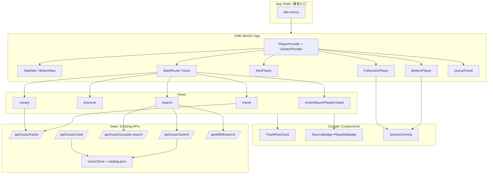

# ONE MUSIC — 阶段二：产品设计与交互架构规划

> 文档版本：Phase 2 / v1  
> 日期：2026-11-13 (UTC)  
> 工作区：`/tmp/duyi-one-music`（隔离 worktree），分支 `feature/one-music`，基线 `origin/main@d5f042f`，已保护整合 `7bd656e`。  
> 性质：**仅设计与规划**。不修改现有音乐业务逻辑、不删除旧组件、不改变生产 API/数据库、不部署生产、不修改 DNS、不创建收费资源、不覆盖原始仓库、不合并其他本地独有提交。

---

## 1. 产品定位

- **产品名称**：ONE MUSIC（所属品牌：独一 ONE）
- **定位**：**Global Music Discovery Platform** —— 全球音乐发现与聆听平台（独一 ONE 全球数字生态中的专业音乐产品）。
- **核心理念**：*让世界各地的音乐能够被发现、搜索、连接和聆听。*
- **产品边界**：不是普通播放器，也不是单纯爬虫页面；是“发现 + 聚合 + 个人体验”的一体化音乐产品，建立在现有 Venus/多来源能力之上并向专业产品演进。

### 三大核心能力

| 能力 | 定义 | 对应现有基础 |
|---|---|---|
| 全球音乐发现 | 从多来源检索与发现音乐，呈现可理解的来源与可播放性 | `/api/music/search`、`/api/music/youtube-search`、`/api/bilibili/search`、`youtubeMusicSearch` 多源并行 |
| 多来源音乐聚合 | 统一来源适配、元数据归一、播放方式（直链/嵌入）与状态管理，合规去重与容错 | `musicStore` + `youtubeMusicSearch` 适配/解析、`/api/music/crawl` 持久化与状态反馈（7bd656e 保护） |
| 个人音乐体验 | 收藏、歌单、历史、队列与跨端一致的播放体验（共享数据与状态） | 现状缺失/弱，需在不破坏现有结构下最小增量演进 |

---

## 2. 产品设计理念

- **Eastern Futurism × Apple-level Minimalism**：东方未来感的克制表达 + 苹果级极简品质；高级、国际化、干净，不做廉价科技风与装饰堆叠。
- **专辑封面即视觉主体**：界面服务于音乐内容，留白充足，层次由排版/间距/明度建立，避免大量边框、阴影、渐变与无意义动画。
- **真实优先**：严禁虚假歌曲、假搜索结果、假播放状态；不同播放方式（直链音频 vs 官方嵌入）必须明确区分，不伪造直链、不绕过平台访问控制与授权。
- **能力不退化**：保留并强化现有爬虫/多源/持久化/API；UI 重构不替代音乐引擎。
- **渐进演进**：基于现有 React 19 + Vite 8 + Tailwind 4 + Express/tsx 栈与现有接口/数据结构做最小必要扩展，先兼容后增强，不重写系统、不直接删旧架构。

### 视觉系统（令牌）

| 角色 | 色值 | 用途 |
|---|---|---|
| Obsidian Black | `#0B0D10` | 深色主背景/沉浸基底 |
| Pure Ivory | `#F4F1EA` | 浅色背景/浅色文字与高亮面 |
| Titanium Silver | `#A7ADB4` | 次级文本、分隔与控件中性态 |
| Jade Green | `#2F6F5E` | 主操作/状态强调（克制使用） |
| Champagne Gold | `#C8A96A` | 品质点缀/精选标识（克制使用） |

- 深色模式为主要体验，浅色模式完整适配；统一图标体系（现有 lucide-react，按产品语义统一）；字体层级清晰；圆角与阴影克制；动画轻盈自然；不使用大量荧光色、不使用廉价玻璃拟态；不模仿其他品牌 Logo/专有界面。

---

## 3. 信息架构（IA）

### 3.1 功能域与页面清单（需求覆盖）

| 模块 | 目的 | 归属策略 |
|---|---|---|
| Home | 个性化入口与精选/继续收听 | 独立主视图 |
| Discover | 全球发现与编辑/来源导向探索 | 独立主视图（与 Search 分工） |
| Search | 主动检索与多来源结果 | 独立主视图（全局可达） |
| Artists | 艺术家聚合与详情 | 详情页（由搜索/发现/曲目进入，可索引列表） |
| Albums | 专辑聚合与详情 | 详情页 |
| Playlists | 歌单浏览与详情 | 独立子视图 + 详情页 |
| Library | 个人音乐库总览 | 独立主视图（聚合入口） |
| Favorites | 收藏曲目/专辑/艺人 | Library 内分段（可深链），避免顶层膨胀 |
| History | 最近播放 | Library 内分段 + Home「继续收听」 |
| Queue | 播放队列与即将播放 | 全局面板/抽屉（桌面侧栏面板，移动全屏/半屏面板），非顶级孤立页 |

### 3.2 简化后的导航结构（避免堆砌）

**桌面侧边导航（一级，5 项 + 底部播放器常驻）**
1. **Home** — 首页/继续收听/精选
2. **Discover** — 发现（来源/场景/开放馆藏）
3. **Search** — 全局搜索（亦可顶部常驻搜索框直达）
4. **Library** — 我的音乐（内含 Tabs/分段：Playlists · Favorites · History · 本地收录/Catalog）
5. **Playlists** — 快速入口（可与 Library 内 Playlists 同路由，侧栏保留快捷以降低深度）

> Artists/Albums 作为**内容详情视图**从卡片/列表进入，不占一级导航；Queue 为**全局播放器附属面板**（任何视图可唤起）。

**移动底部导航（4 项，克制）**
1. **Home**  2. **Discover**  3. **Search**  4. **Library**（Library 内再分段 Playlists/Favorites/History）  
迷你播放器固定于底部导航上方；Queue 由播放器/操作入口唤起。

### 3.3 路由与兼容策略

- 现有入口 `tab=venus`（`App.tsx`）**保留**作为兼容壳，逐步将内容替换/嵌入 ONE MUSIC 视图容器；命令面板/侧栏/地球仪/AI 伴侣跳转 `venus` 继续有效。
- 新增子视图建议采用**内部视图状态或 hash/子路径约定**（实现阶段选型，以不破坏现有 tab 机制为前提），并支持深链（如搜索词、专辑/艺人 id、队列面板态）与状态恢复。

---

## 4. 桌面端页面规划

**整体布局**：左侧可折叠导航 + 主内容区 + 底部固定全局播放器；Queue 作为右侧/覆盖面板按需展开。层次靠排版与留白，不做卡片墙与后台表格感。

| 区域/页面 | 结构与内容 | 交互要点 |
|---|---|---|
| 侧边导航 | ONE MUSIC 标识、Home/Discover/Search/Library/Playlists、折叠态图标化 | 当前视图高亮；折叠不挤压播放器与主内容可读性 |
| 顶部区（主内容内） | 全局搜索/上下文标题/筛选（来源、可播放类型、时长等） | 搜索即时反馈、空态/错误态明确 |
| Home | 欢迎/继续收听、精选与开放馆藏推荐、最近播放片段、全球发现入口 | 封面主导，分组克制 |
| Discover | 来源/场景/地区向发现（基于可用开放源与聚合结果），不伪造内容 | 展示来源与可用性 |
| Search 结果 | 统一结果列表：封面、歌名、艺人、专辑、**来源标识**、时长、**播放方式（直链/嵌入）**、可播放状态；同曲目可展开来源选择 | 并发聚合、超时/失败可见、去重合并展示 |
| Artists/Albums/Playlists 详情 | 头图区（封面/元信息）+ 曲目列表 + 操作（播放全部/加入队列/收藏） | 列表支持批量入队 |
| Library | 分段：Playlists / Favorites / History / 已收录（`/api/music/tracks` 持久化目录视图） | 与账户数据模型对齐（阶段三+ 落地存储策略按最小改进） |
| 底部播放器 | 封面、歌名/艺人、收藏、上/播停/下、进度、音量、播放模式、队列入口、音源/播放方式状态 | 常驻；错误与音源切换可见 |
| Queue 面板 | 当前播放、即将播放、历史顺序/手动排序（规划） | 不遮挡主任务；可关闭 |

---

## 5. 手机端页面规划（独立设计）

**原则**：单列纵向流、拇指可达、触控目标 ≥ 44px 视觉可点区域；不缩放桌面布局；桌面/手机/平板共享**同一套音乐数据与播放状态**。

| 区域/页面 | 规划 |
|---|---|
| 顶部 | 品牌/上下文 + 搜索入口（可吸顶收缩） |
| Home/Discover | 纵向分节，封面与标题优先，大图卡片极少且克制 |
| Search | 输入即/提交检索，结果列表紧凑清晰（来源/播放方式/状态徽标） |
| Library | 分段切换（Playlists/Favorites/History/收录） |
| 详情页（艺人/专辑/歌单/曲目上下文） | 大封面头 + 列表 + 主操作浮于内容末/与迷你播放器协调 |
| 底部导航 | 4 项固定；安全区 `env(safe-area-inset-bottom)` |
| 迷你播放器 | 固定于底部导航**上方**，显示封面/标题/播停/下一首；点击展开全屏 |
| 全屏播放页 | 大封面、主控件、进度、模式、队列/歌词入口、音源与错误提示；嵌入源时呈现内嵌播放器容器与明确说明 |
| Queue/列表 | 全屏或半屏面板，可滑动；避免与系统手势冲突 |

**适配**：iOS Safe Area、安卓导航栏/手势区、横向溢出防护、底部导航与迷你播放器不遮挡内容（预留 padding）。

---

## 6. 播放器交互方案

### 6.1 统一播放器能力（单一播放状态源）

- 元信息：当前歌曲、专辑封面、艺人、专辑、来源与许可提示（展示层）。
- 控制：播放/暂停、上一首/下一首、进度条拖动（seek）、音量、静音。
- 模式：随机、单曲循环、列表循环（互斥/组合规则明确，默认列表顺序）。
- 队列：查看/编辑即将播放、从列表/详情/搜索结果入队与插播（规划语义一致）。
- 体验：收藏、歌词入口（有则展示/无则占位说明）、**音源切换**（同曲目多来源候选时）、播放错误提示与重试/切源建议。
- 系统集成：研究并规划 **Media Session API**（元数据、播放控制、封面），在支持环境启用。
- 状态恢复：持久化当前曲目/队列索引/进度/模式/音量（本地优先，账户同步为后续能力），异常中断可恢复。

### 6.2 播放方式与约束（必须区分）

| 类型 | 条件 | 行为 |
|---|---|---|
| 直链音频 | 可信 `audioUrl` 且允许跨域/播放 | `<audio>` 播放，支持进度/音量/可视化（在可用时） |
| 官方嵌入 | `embedUrl` / 平台嵌入（YouTube/B站等） | iframe/官方播放器；进度/音量受平台限制，UI 须提示“嵌入播放”并避免伪装为可 seek 的直链 |
| 不可播 | 无可用源或受限 | 明确不可播状态与原因提示，不伪造地址 |

### 6.3 全屏播放（桌面/移动差异化呈现，共享状态）

- **桌面**：主内容区内沉浸面板或居中舞台，保留全局导航可达与底栏/队列联动。
- **移动**：自迷你播放器上滑/点击进入全屏；大封面、纵向控件栈、底部操作区避开 Home Indicator。
- **共用**：同一 `playerState`（currentTrack, queue, index, mode, position, volume, sourceChoice, error）。

---

## 7. 搜索与发现方案

- **搜索入口**：全局搜索框（桌面常驻/移动顶部）+ Search 视图；支持歌曲名、艺术家、专辑、歌单/关键词；支持粘贴 URL 解析（复用 `resolveMusicEmbedUrl` 能力）。
- **聚合策略**：并发调用现有可用端点/适配器（`/api/music/search`、`/api/music/youtube-search`、`/api/bilibili/search` 及持久化目录），带**超时控制**与**部分失败可用**（返回可用子集 + 错误摘要）。
- **结果呈现**：封面、歌名、艺人、专辑、来源标识、时长、播放方式（直链/嵌入）、可播放状态；同一首歌曲**合理去重/合并**，保留**来源选择**（多音源切换）。
- **发现**：基于开放馆藏/已收录与来源特性分组（非虚构榜单）；可复用 genre/场景标签与已持久化曲目。
- **合规**：不伪造音源、不绕过访问控制、不抓取未授权受保护内容；许可与来源链接可追溯展示。

---

## 8. 多来源爬虫架构

### 8.1 现有能力（必须保留，接口不变）

- 来源与能力：Internet Archive / Free Music Archive（含 IA 索引路径）、YouTube 搜索与嵌入、Bilibili 搜索与嵌入、SoundCloud/Mixcloud/Bandcamp/直链 URL 解析、现有适配器与真实开放音频获取。
- 持久化：`musicStore` → `data/venus_music_catalog.json`（cwd 相对，现状保持）；元数据与可播/嵌入 URL 入库。
- API：`GET /api/music/tracks`、`GET /api/music/search`、`GET /api/music/youtube-search`、`POST /api/music/crawl`、`GET /api/bilibili/search`（请求/响应兼容扩展，不破坏既有字段与调用方）。

### 8.2 统一来源适配层（目标架构，渐进落地）

```
[Search/Crawl Request]
        │
        ▼
  ┌───────────────┐
  │ Aggregation   │  并发/超时/熔断/部分成功汇总
  └──────┬────────┘
         │ 调度
 ┌───────┼────────┬─────────┬──────────┐
 ▼       ▼        ▼         ▼          ▼
[IA/FMA] [YouTube][Bilibili][URL解析] [Future...]
 Adapter  Adapter  Adapter  Adapter    Adapter
 └───────┴────────┴─────────┴──────────┘
         │ 统一输出 MusicSourceResult
         ▼
  ┌───────────────┐
  │ Normalize &   │  去重/合并/优先级/可播放判定
  │ Dedupe        │
  └──────┬────────┘
         ▼
  Track/Playable + Status + Cache/Persist(按策略)
```

**适配器契约（统一输出，兼容现有字段）**：`id`, `title`, `artist`, `album`, `coverUrl`, `durationSeconds`, `source`, `sourceId/sourceUrl`, `license`, `playback: { type: 'audio'|'embed'|'none', audioUrl?, embedUrl?, provider? }`, `availability`, `fetchedAt/crawledAt`, `qualityHints?`, `errors?`。  
> 与现有 `MusicTrack`/前端 `playable+audioUrl+embedUrl` **向后兼容映射**；实现阶段可先在聚合层做归一，逐步内收适配器。

### 8.3 并发、容错与质量策略

- **并发与超时**：各适配器独立超时（复用/对齐现有 fetch timeout），总体 deadline，先返回可用结果。
- **失败与重试**：网络/解析失败分类上报；对幂等检索做有限重试（退避），不阻塞其他来源；UI 展示来源级状态（7bd656e 反馈模式延续）。
- **去重与合并**：规范化 key（`sourceUrl`/平台 id/标题+艺人+时长近似）合并同曲目多音源，保留候选列表。
- **音源优先级**（可配置策略）：可播放直链开放源（可控）> 官方嵌入可用 > 仅信息不可播；同等时按稳定性/历史成功率与来源偏好。
- **失效检测**：播放失败/加载错误标记候选失效，触发切源或提示；持久化条目可记录最近校验状态（增量字段，兼容旧数据）。
- **任务与缓存**：检索结果短 TTL 内存缓存；crawl 作为持久化收录任务返回进度/计数/错误（现有同步返回语义保留，后续可扩展任务 id）；持久化仍以 `musicStore.save()` 与现有目录为准。

### 8.4 合规与安全边界

- 仅使用官方嵌入、公开接口或明确开放/授权的直链；不下载/分发未授权受保护内容；不绕过登录/DRM/访问控制；Jamendo 等需 key 的来源在未配置时明确不可用（现有行为保留）。

---

## 9. 组件结构

### 9.1 组件分层（目标，渐进从 `VenusMusicSpace` 抽离）

```
App (tab=venus 兼容壳)
└─ OneMusicApp (布局壳：Desktop/Mobile 变体，共享状态 Provider)
   ├─ MusicNav / MusicSideRail (桌面)
   ├─ MusicTopBar (搜索/上下文)
   ├─ MusicMainRouter
   │   ├─ HomeView
   │   ├─ DiscoverView
   │   ├─ SearchView (ResultsList, SourceFilter, PlayableState)
   │   ├─ LibraryView (Tabs: Playlists|Favorites|History|Catalog)
   │   ├─ PlaylistDetail / AlbumDetail / ArtistDetail
   │   └─ (QueuePanel 作为全局 Overlay/Pane)
   ├─ MiniPlayer (移动，导航上方)
   ├─ BottomPlayerBar (桌面常驻)
   └─ FullscreenPlayer (覆盖层，桌面/移动不同布局)

共享/领域组件：TrackRow, TrackCard, CoverArt, SourceBadge, PlaybackBadge,
QueueList, ProgressSeek, VolumeControl, PlaybackModeControls, EmptyState, ErrorState
```

### 9.2 状态与服务边界

- **PlayerState（全局单例）**：当前曲目、队列、索引、模式、进度、音量、播放方式/音源选择、错误；驱动 mini/bottom/fullscreen 与 Media Session。
- **LibraryState**：收藏/歌单/历史/已收录视图模型（初期可本地持久化 + 读取 `/api/music/tracks`，账户级同步为后续最小增量）。
- **Search/Discovery 服务**：封装现有 fetch 调用与结果归一，不改变后端契约。
- **保留**：`VenusMusicSpace` 可在过渡期作为引擎/数据源参考或子模块，直至等价能力迁移完成再下线（阶段三+ 分步，非本阶段操作）。

### 9.3 组件关系图



---

## 10. 技术架构

- **前端**：React 19 + TypeScript，Vite 8，Tailwind 4（`@tailwindcss/vite`），`lucide-react` 图标；路由沿用现有 tab/state 机制（`App.tsx` `currentTab`），内部视图可增量引入轻量状态路由而不强制全局路由重写。
- **状态管理**：优先 `React Context + useReducer`（或等价轻量方案）实现 `PlayerStore`/`LibraryStore`，避免引入重型依赖与重复播放器实例；与现有组件树兼容。
- **后端**：Express（`tsx server.ts`），现有 `musicStore`、`youtubeMusicSearch`、B站搜索与路由保持；聚合/归一逻辑可先前端聚合 + 后端能力复用，必要时再以后端聚合端点增量扩展（**不改现有端点语义**）。
- **API 边界**：前端只依赖既有契约与可选新增只读字段；写操作（crawl）保持 `POST /api/music/crawl`；用户态数据（收藏/歌单/历史）若需服务端持久化，后续以新增接口/存储设计，避免破坏现有 music API。
- **缓存与性能**：前端请求去重/短缓存、列表虚拟化按需评估；封面懒加载；避免复杂无意义动画。
- **音频/嵌入**：HTMLAudio + Web Audio（可视化按能力启用）+ iframe 官方嵌入并存；统一抽象播放适配但尊重平台控件限制。

### 现有架构不足与最小改进方案（不删旧架构）

| 问题 | 影响 | 最小改进 |
|---|---|---|
| 播放/搜索/UI 状态集中在单体组件 | 难以复用到迷你/全屏/多视图，跨端一致难 | 抽离 `PlayerContext` + `useMusicApi` hooks；保留旧组件直至迁移完成 |
| 无统一队列/收藏/历史/歌单模型 | 个人体验不完整 | 定义前端模型与本地持久化（localStorage/IndexedDB 视实现）作为 MVP；服务端同步后置 |
| 曲目类型分散（server/frontend 各定义） | 归一与来源切换易错 | 增量引入共享类型/映射函数（如 `src/types/music.ts`）并兼容现有字段 |
| `crawl` 与实时搜索语义不同但 UI 易混淆 | 用户预期不清 | 设计上明确“收录/持久化抓取”与“实时聚合检索”两条路径与状态文案（沿用 7bd656e 反馈） |
| 持久化路径依赖 `cwd/data` | 多环境一致性风险 | 维持现状；文档化约束，后续仅在需要时通过可配置路径最小改动（本阶段不改） |

---

## 11. 数据模型

### 11.1 现有模型（必须兼容）

**服务端 `server/musicStore.ts` — `MusicTrack`**：  
`id, title, artist, album, genre, durationSeconds, audioUrl, coverUrl, source, sourceUrl, license, crawledAt, bpm?, description?`（持久化于 `venus_music_catalog.json`）。

**前端当前扩展（`VenusMusicSpace`）**：`embedUrl?`, `playable?: 'audio'|'embed'` 等展示/播放辅助字段。

**现有 API 响应核心**：`{success, tracks|results|videos, count?, query?, errors?, crawledCount?, savedCount?, newTracks?, message?}`（以各端点现状为准，兼容扩展）。

### 11.2 规划模型（增量、向后兼容）

```ts
// 归一播放能力（兼容现有 audioUrl/embedUrl/playable）
type PlaybackKind = 'audio' | 'embed' | 'none';
interface PlaybackInfo {
  kind: PlaybackKind;
  audioUrl?: string;
  embedUrl?: string;
  provider?: string; // youtube | bilibili | soundcloud | archive | direct ...
}

// 统一曲目视图模型（可由现有 Track 映射得到）
interface UnifiedTrack {
  id: string;                 // 稳定主键（优先 sourceId/sourceUrl 派生或既有 id）
  title: string;
  artist: string;
  album?: string;
  coverUrl?: string;
  durationSeconds?: number;
  source: string;             // 来源展示名
  sourceUrl?: string;
  license?: string;
  playback: PlaybackInfo;
  availability: 'playable' | 'embed-only' | 'unavailable' | 'unknown';
  crawledAt?: string;
  tags?: string[];
  alternateSources?: UnifiedTrack[]; // 同曲目其他可播来源
}

// 播放器状态
interface PlayerState {
  queue: UnifiedTrack[];
  currentIndex: number;       // -1 = none
  isPlaying: boolean;
  positionSec: number;
  durationSec?: number;
  volume: number;             // 0..1
  muted: boolean;
  mode: { shuffle: boolean; repeat: 'off'|'one'|'all' };
  activeSourceKey?: string;
  error?: { code: string; message: string; at: string };
}

// 个人库（MVP 本地优先，后续可同步）
interface UserMusicLibrary {
  favorites: { trackId: string; addedAt: string }[];
  playlists: { id: string; name: string; trackIds: string[]; updatedAt: string }[];
  history: { trackId: string; playedAt: string; progressSec?: number }[];
}
```

**映射原则**：旧字段直通、新字段可选；缺失能力降级为 `unknown/unavailable` 而非臆造。

---

## 12. 开源项目研究与许可证

> 依据 GitHub API 元数据与阶段一核查（2026-11-13）；仅借鉴交互/架构/布局理念，不复制品牌、商标、图标或整套代码。

| 项目 | 维护/技术栈信号 | 许可证 | 可借鉴 | 风险/限制 |
|---|---|---|---|---|
| [lucashanak/music-seeker](https://github.com/lucashanak/music-seeker) | pushed 2026-10-16；JS；自托管搜索/下载/播放器、Navidrome 等集成 | **未检出（API null）→ 默认保留权利** | 多来源搜索与状态呈现的信息组织思路（理念） | **不得复用代码**；其下载/抓取链路含版权敏感能力，ONE MUSIC 仅做合规发现与播放方式区分 |
| [ardianryan/Convx-Web](https://github.com/ardianryan/Convx-Web) | pushed 2026-11-01；Svelte；YouTube Music 流式移动端 Web 方向 | **GPL-3.0** | 播放器层级与移动端交互节奏（理念） | 强 copyleft；**避免引入代码**；重玻璃/弹性动效与本产品克制美学不符，需取舍 |
| [harshitethic/OpenTune](https://github.com/harshitethic/OpenTune) | pushed 2026-10-25；HTML/轻量前端；搜索/播放/队列/推荐/可选账户 | **MIT** | 首页分区、搜索-队列-播放闭环的 IA 思路 | 若未来复用代码须保留版权与许可；当前自研实现 |
| [monochrome-music/monochrome](https://github.com/monochrome-music/monochrome) | pushed 2026-11-07；JS；PWA/极简播放器取向，star 活跃 | **Apache-2.0** | 极简列表密度、播放器状态反馈与 PWA 体验模式（理念） | 复用代码需保留 License/NOTICE；其内容来源/分发模式不直接适用，须遵守合规 |

**结论**：架构与交互参考“多源聚合 + 统一播放器状态 + 清晰播放方式标识 + 克制 IA”共性；实现坚持项目自研与现有引擎，遵守各许可证与平台条款。

---

## 13. 开发优先级

| 优先级 | 阶段目标 | 说明（保护现有能力） |
|---|---|---|
| P0 | 统一播放器状态与壳层 | 抽离 Player 状态、接入现有 audio/embed 播放与 7bd656e 搜索/爬取反馈；不改 API |
| P0 | 桌面 IA 落地 | 侧栏 + 主视图 + 底部播放器 + Queue 面板（Home/Discover/Search/Library 最小可用） |
| P1 | 搜索与结果体验 | 多来源并发/超时/部分失败、来源与播放方式/可播状态展示、去重与音源选择 UI |
| P1 | 移动独立体验 | 底部导航 + 迷你播放器 + 全屏播放、安全区与遮挡处理，共享状态 |
| P2 | 个人音乐体验 MVP | Favorites/History/Queue 持久化、Playlists 基础、继续收听；优先本地一致性 |
| P2 | 详情与发现深化 | Artists/Albums/Playlists 详情聚合视图、Discover 内容编排（基于真实数据） |
| P3 | 增强 | Media Session 完善、歌词能力（有源才显）、音源失效检测与切换策略优化、可选后端聚合/同步接口（新增不破坏） |

---

## 14. 测试标准

> 阶段四执行；标准在此锁定。**必须验证真实音频可播/真实检索与状态**，不得仅测页面可开。

**功能与真实链路**
1. 首页/发现/搜索/库视图可达与状态正确。
2. 全局音乐搜索（歌名/艺人/专辑/关键词）与多来源聚合；超时/失败提示。
3. 结果去重与同曲多来源选择；来源/时长/播放方式/可播状态准确。
4. 直链音频真实播放；官方嵌入真实可播；播放失败反馈与切源/重试路径。
5. 播放控制：播停、上下首、进度拖动（直链）、音量、随机/循环模式；队列增删与顺序。
6. 收藏、播放历史、继续收听、（MVP）歌单与播放状态恢复。
7. 固定/开放源爬虫与持久化：`/api/music/crawl` 真实获取与 `tracks`/目录更新可见，状态反馈正确（保留 7bd656e 行为）。
8. API 兼容：`/api/music/tracks|search|youtube-search|crawl`、`/api/bilibili/search` 契约不回归。

**体验与适配**
9. 桌面端布局（侧栏/主内容/底部播放器/队列面板）与浅/深色。
10. 手机端独立布局：底部导航、迷你播放器、全屏播放、触控与 Safe Area、无横向溢出、无遮挡。
11. 桌面/手机/平板共享同一播放与库状态（同会话/同账户策略按实现阶段验证）。

**工程**
12. 每阶段 `lint`、`build`、针对性测试通过；改动范围可控；不引入虚假数据与未授权内容。

---

## 15. 线框图

> 线框图用于准确表达布局与交互（结构性示意，非装饰图）。

### 15.1 桌面端首页线框图

```
┌──────────────────────────────────────────────────────────────────────────────┐
│ ONE MUSIC (brand)                                      [Search.............]│
├──────────────┬───────────────────────────────────────────────────────────────┤
│ ▸ Home       │  Home / 继续收听                                               │
│   Discover   │  ┌──────────────┐  ┌──────────────┐  ┌──────────────┐         │
│   Search     │  │ Cover        │  │ Cover        │  │ Cover        │  ...    │
│   Library    │  │ Title        │  │ Title        │  │ Title        │         │
│   Playlists  │  │ Artist · Src │  │ Artist · Src │  │ Artist · Src │         │
│              │  └─────▶ Play  ┘  └──────────────┘  └──────────────┘         │
│  (collapse)  │                                                               │
│              │  精选 / 开放馆藏发现                                            │
│              │  ┌─────────────────────────────────────────────────────────┐  │
│              │  │ Track Row: [Cover][Title/Artist][Album][Src][⏱][▶/＋]   │  │
│              │  │ Track Row: ...  (可播状态/嵌入标识清晰)                  │  │
│              │  └─────────────────────────────────────────────────────────┘  │
├──────────────┴───────────────────────────────────────────────────────────────┤
│ [Cover] Title — Artist   [♡] [⏮][⏯][⏭]  ──●────────  1:23/4:56  [🔀][🔁]  │
│ Source: Archive·直链      [Queue] [Vol ──●──]  [音源/状态]                    │
└──────────────────────────────────────────────────────────────────────────────┘
  (可选右侧滑出 Queue Panel：Now Playing / Up Next / History)
```

### 15.2 手机端首页线框图

```
┌────────────────────────────┐  ← safe area
│ ONE MUSIC        [🔍 搜索]  │  顶部（可吸顶）
├────────────────────────────┤
│ 继续收听                    │
│ ┌────┐ ┌────┐ ┌────┐      │  横滑/分组（克制）
│ │Cov │ │Cov │ │Cov │ ...  │
│ └────┘ └────┘ └────┘      │
│ 为你发现 / 开放馆藏         │
│ ┌────────────────────────┐ │
│ │[Cov] Title            │ │
│ │Artist · Source · 直链  │▶│
│ └────────────────────────┘ │
│ ┌────────────────────────┐ │
│ │ ... track rows ...     │ │
│ └────────────────────────┘ │
│            (content padding bottom for mini+nav)
├────────────────────────────┤
│ ┌[Cov] Title — Artist  [⏯][⏭]┐ │  Mini Player（点按展开全屏）
├────────────────────────────┤
│  Home  Discover  Search  Lib │  Bottom Nav
└────────────────────────────┘  ← safe area
```

### 15.3 全屏播放器线框图

```
桌面（沉浸面板/舞台）                         移动（全屏页）
┌───────────────────────────────┐          ┌────────────────────────┐
│ [↓] Now Playing        [Queue]│          │ [⌄ 收起]        [⋯]   │
│  ┌─────────────────────────┐  │          │                        │
│  │                         │  │          │   ┌──────────────┐     │
│  │      Album Cover        │  │          │   │              │     │
│  │                         │  │          │   │  Album Cover │     │
│  └─────────────────────────┘  │          │   │              │     │
│  Title                         │          │   └──────────────┘     │
│  Artist · Album · Source       │          │   Title                │
│  [直链/嵌入状态] [音源切换▾]    │          │   Artist · Source      │
│  ───────●────────────  1:23    │          │   [嵌入播放器区域/提示] │
│     [🔀] [⏮] [⏯] [⏭] [🔁]      │          │   ──●────────  1:23    │
│  [♡]  [歌词]  [音量 ─●─]        │          │   [⏮]   [⏯]   [⏭]       │
│  (Embed: 显示官方播放器控件区)  │          │ [🔀][♡][歌词][🔁][Queue]│
└───────────────────────────────┘          └────────────────────────┘
          ↑ 共享同一 PlayerState（队列/模式/进度/音源/错误）
```

### 15.4 搜索结果线框图

```
┌──────────────────────────────────────────────────────────────┐
│ Search: [ 关键词 / URL ............................ ] [Go]   │
│ Filters: [来源▾] [播放方式:全部/直链/嵌入▾] [可播▾]  状态: ⏳部分来源超时 │
├──────────────────────────────────────────────────────────────┤
│ 结果（去重分组，同曲可展开来源）                                │
│ ┌────┐ Title A                                   [▶] [＋队列] │
│ │Cov │ Artist · Album · 03:42 · [YouTube·嵌入] [可播]  [来源▾] │
│ └────┘  ↳ 其他来源: Bilibili(嵌入) / Archive(直链,失败重试)     │
│ ──────────────────────────────────────────────────────────── │
│ ┌────┐ Title B                                   [▶] [＋]     │
│ │Cov │ Artist · Album · --:-- · [Internet Archive·直链] [可播] │
│ └────┘  许可/来源链接 ↗                                       │
│ ──────────────────────────────────────────────────────────── │
│ [空态/无结果/错误态：明确文案，不展示虚假条目]                  │
└──────────────────────────────────────────────────────────────┘
交互：并发加载骨架 → 渐进填充；单条失败不阻塞全局；点击播放即入队并驱动全局播放器
```

### 15.5 组件关系图

见 **9.3 组件关系图**（Mermaid：Shell → OneMusicApp → Provider/Nav/Main/Players/Queue → Views/Domain/Data）。

---

## 16. 与现有实现一致性检查

- **API 保持不变**：`/api/music/tracks`、`/api/music/search`、`/api/music/youtube-search`、`/api/music/crawl`、`/api/bilibili/search` 的路径、方法与既有语义/字段兼容；`crawl` 继续返回 `success/crawledCount/savedCount/newTracks/errors/message`（7bd656e）。
- **数据与存储**：`data/venus_music_catalog.json` 与 `musicStore` 行为保留；新增用户态数据采用独立、可选存储策略，不覆盖曲库文件。
- **前端入口**：`App.tsx` 的 `venus` tab、侧栏/命令/地球仪/AI 跳转保持；`VenusMusicSpace`/`VenusCreativeStudio` 不在本阶段删除或改逻辑。
- **播放能力**：直链 audio 与官方嵌入并存，来源/许可可追溯，不伪造可播放性。

---

## 17. 阶段三启动前提（待指令）

1. 在 `feature/one-music` 上按 P0→P1 渐进实施，优先抽离播放器状态与布局壳，不破坏旧路径。  
2. 实施前后各执行并记录 `lint/build` 与针对性测试；真实播放/搜索/爬取与持久化必须验证。  
3. 每独立子阶段提交并推送；未经批准不部署生产、不改 DNS/D1/Worker/收费资源。  

**文档状态：阶段二设计与规划完成，待评审后进入阶段三。**
